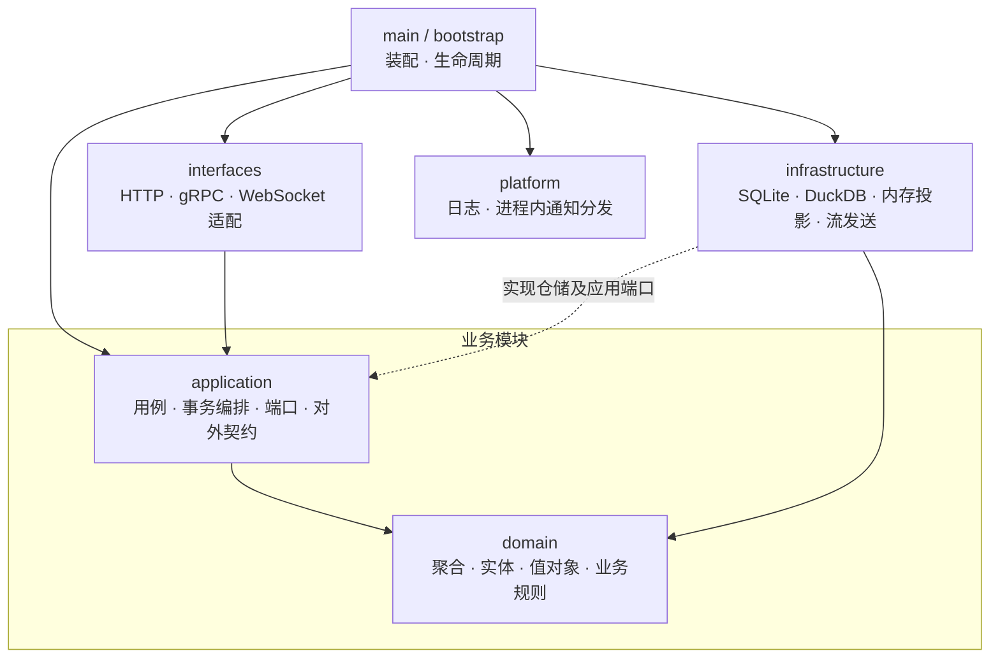
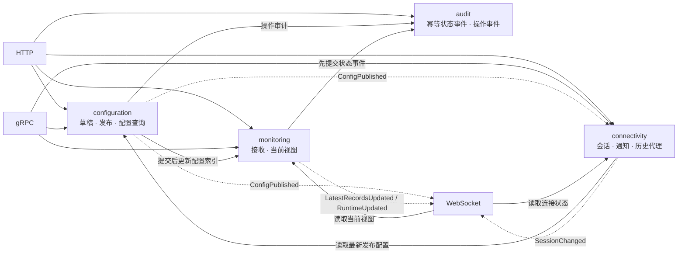

# App

App 管理配置草稿与发布版本、网关会话、功能最新记录和业务事件，并转发历史查询。
浏览器端的配置编辑、交互校验及展示流程见[前端设计](./frontend.md)。

## DDD 架构与模块边界

App 采用 DDD 模块化单体，在一个进程内按业务边界组织模块，通过明确的应用接口协作。领域模型承载业务规则，应用层编排用例与事务，接入层转换协议，基础设施实现存储和通信。main 仅负责依赖装配、入口注册及生命周期。

### 领域划分

| 模块 | 业务边界及拥有的数据 | 对外应用能力 |
| --- | --- | --- |
| configuration：配置管理，核心领域 | 网关草稿、已发布配置、设备与通信配置及功能、发布版本；负责完整性、归属、差异与版本规则 | 保存及查询完整草稿、发布配置、读取已发布配置及网关同步增量 |
| monitoring：运行监控领域 | 当前配置的只读索引、功能最新记录、网关运行快照及连接问题；负责功能存在性、时间顺序和当前状态替换规则 | 应用配置索引、接收读数及状态快照、读取当前视图并产生变化通知 |
| connectivity：网关接入支撑模块 | 当前会话、会话标识、待响应请求及配置通知任务；负责流替换、请求关联、取消、超时及通知重试 | 登记及结束会话、提交响应、发送请求、转发历史查询、通知配置版本 |
| audit：事件审计支撑模块 | App 接收的状态事件、用户操作与报错事件及去重标记 | 幂等提交状态事件、追加操作与报错事件、查询 App 事件 |

配置管理拥有配置事实，运行监控仅维护服务于查询和接收校验的内存投影。连接是否在线来自当前平台流，设备连接问题来自网关快照，功能读数状态来自最新结果，分别建模。网关历史数据归 Gateway 所有，App 的历史查询是 connectivity 的代理用例，不建立本地历史聚合。

HTTP、gRPC、WebSocket、事件分发、SQLite、DuckDB 和日志均为技术设施，不作为业务领域。connectivity 以会话状态机和任务编排为主，audit 以追加和查询为主，按实际规则实现，不为每个模块强制建立聚合或领域服务。

### 聚合与一致性

配置领域以 GatewayConfiguration 为已发布配置聚合根，gatewayId 为聚合标识；设备、通信配置及功能是聚合内部对象，修改经聚合行为完成。GatewayDraft 是按 gatewayId 独立保存的完整草稿，允许未完成参数；发布时转换为满足全部不变量的候选配置。草稿和已发布配置各自拥有独立内容，保存草稿不改变已发布聚合。

聚合行为负责发布校验、按 ID 和字段值比较、计算影响范围与版本。实体表达标识及归属，值对象表达协议参数、精度、间隔和结果等规则；仅跨实体且无法自然归属的业务规则提取为领域服务。数据库行、HTTP DTO 和 Protobuf 消息均不直接充当领域对象。

同一网关的配置发布用例串行执行至配置索引更新及通知登记完成，工作单元在同一 SQLite 事务中读取草稿与当前已发布配置、执行领域行为、保存变更及版本并提交。草稿保存与发布的配置写入由同一存储写入入口串行协调。仓储以聚合为单位提供加载和保存入口，内部可按变更集更新多张表，不建立逐表可独立修改的设备、通信和功能仓储。物理结构见[持久化结构](./database.md#app-sqlite)。

运行监控按网关保护内存视图，配置索引替换、对象清理、存在性检查和结果更新使用同一同步边界。最新读数和运行快照是查询投影，不通过持久化聚合仓储写入。时间比较及结果互斥等纯规则放在 monitoring/domain，锁、索引及通知协调放在应用服务与内存适配器。

SQLite 配置提交、DuckDB 审计提交和内存投影更新分别有自己的边界。配置提交后同步更新当前配置索引，再发出通知；发布成功以配置事务提交为依据，操作审计失败只记录诊断。状态接收先提交审计及去重标记，成功后更新当前视图并确认；审计失败不替换当前视图。进程内事件用于后续通知，不承担这些必要步骤，也不提供跨存储事务。该设计使用普通状态存储和读取投影，不以事件日志重建业务状态。

### 分层职责与依赖

图中实线表示源码依赖，虚线表示适配器实现内部端口；端口由使用方声明，运行时通过装配注入实现。



| 层或组件 | 职责及限制 |
| --- | --- |
| domain | 维护业务不变量并返回业务结果及变化事实；不依赖 SQL、网络、框架、调度器、事件分发器或其他模块内部模型 |
| application | 提供命令与查询入口，完成权限及归属检查、加载模型、调用领域行为、事务编排、必要投影更新和提交后通知；不实现数据库及网络细节 |
| interfaces/http | 认证、输入结构校验、DTO 转换及结果映射，调用应用入口；权限最终由应用入口检查，接口契约见 [App 前端接口](./api.md) |
| interfaces/grpc | 认证流身份、编解码、消息路由；将生命周期与响应交给 connectivity，将配置请求及上报交给对应应用入口；不修改领域和投影 |
| interfaces/websocket | 管理连接及授权订阅，消费应用通知、读取应用查询视图并推送；持有有界推送队列，不修改业务状态 |
| infrastructure | 实现内部接口，负责 SQL、数据映射、事务资源、归档、内存同步和每条流的串行写入；不自行决定发布版本或接收规则 |
| bootstrap / platform | bootstrap 装配全部实现并管理生命周期；platform 提供窄小技术能力，不放业务流程和通用业务仓储 |

领域仓储接口位于所属 domain，工作单元、审计写入、投影更新、消息发送、通知发布等用例端口位于使用方 application。application 只依赖接口，具体实现位于 infrastructure，由 bootstrap 注入。模块间通过公开 application 契约和不可变 DTO 协作，不读取对方表、缓存或聚合内部对象；跨模块适配器调用目标模块应用入口。

网关接收循环只负责解码、路由和交付响应，业务处理交给应用任务执行，等待响应不能阻塞接收循环。connectivity 通过注入的发送端口使用当前流；gRPC 适配器通过应用入口登记会话并交付响应，双方不相互构造或管理资源。

设计依据：[DDD 分层与领域模型](https://learn.microsoft.com/en-us/dotnet/architecture/microservices/microservice-ddd-cqrs-patterns/ddd-oriented-microservice)、[领域事件与应用处理](https://learn.microsoft.com/en-us/dotnet/architecture/microservices/microservice-ddd-cqrs-patterns/domain-events-design-implementation)。

### 项目目录

以下是 App 服务端目录；前端和 Gateway 分别维护自己的结构。业务模块内部再分层，目录表示职责位置，按实际类型创建文件。

```text
app/
├── cmd/app/                         # main：调用 bootstrap 启停
└── internal/
    ├── bootstrap/                   # 装配、注册入口与订阅、启动关闭
    ├── configuration/
    │   ├── domain/                  # GatewayConfiguration、GatewayDraft、规则、仓储接口
    │   ├── application/             # 草稿/发布/配置查询用例、工作单元和跨模块端口
    │   └── infrastructure/          # SQLite 仓储与工作单元、跨模块端口适配
    ├── monitoring/
    │   ├── domain/                  # 采集结果、快照、时间及状态替换规则
    │   ├── application/             # 接收用例、当前视图查询、投影及审计端口
    │   └── infrastructure/          # 内存索引和同步、审计端口适配
    ├── connectivity/
    │   ├── application/             # 会话、请求关联、历史代理、配置通知任务及端口
    │   └── infrastructure/          # 流发送端口实现、配置查询端口适配
    ├── audit/
    │   ├── application/             # 幂等状态提交、事件追加及查询、存储端口
    │   └── infrastructure/          # DuckDB 写入/去重、Parquet 归档和查询
    ├── interfaces/
    │   ├── http/                    # 配置、当前视图、历史与事件接口
    │   ├── grpc/                    # 认证流、协议映射、生命周期和消息路由
    │   └── websocket/               # 订阅、当前快照衔接、推送消费任务
    └── platform/
        ├── notification/            # 类型化进程内通知分发
        └── logging/                 # 结构化诊断
```

配置同步属于 connectivity 的应用任务，数据接收属于 monitoring 的应用用例，当前视图属于 monitoring 的查询投影，持久化事件属于 audit。协议生成类型留在通信适配边界，不进入 domain；基础设施数据行仅用于持久化映射。目录边界通过包依赖检查和代码评审维护。

### 事件分发与模块协作

下图表示运行时模块协作，实线是应用入口调用，虚线是提交后的进程内通知，均通过前述契约及端口连接。



领域行为只产生配置发布等业务事实，不直接调用分发器。应用服务在事务提交及必要投影更新完成后，将事实转换为进程内通知；SessionChanged、LatestRecordsUpdated、RuntimeUpdated 是会话或查询投影的应用通知，不作为领域聚合事件。

内部事件携带事件类型、gatewayId、发生时间及必要的版本、会话或对象标识；关联请求时携带 requestId。事件载荷使用不可变的变更摘要，不传递可修改的共享状态。内部事件与事件库记录各有用途，内部通知不逐条入库。

| 内部事件 | 生产者与发布时机 | 消费者与动作 |
| --- | --- | --- |
| ConfigPublished | configuration 应用服务：发布事务提交且 monitoring 配置索引更新完成后；仅有实际变更时发布，携带 version、受影响对象及采集配置是否变化 | 配置同步在采集配置变化时通知当前最新版本；前端通信推送配置变化及受影响视图 |
| SessionChanged | connectivity 应用服务：认证流登记、替换或结束且当前会话状态更新后，携带会话标识和连接状态 | 配置同步在连接可用时检查最新发布版本，离线时取消等待；前端通信推送当前连接状态 |
| LatestRecordsUpdated | monitoring 应用服务：通过时间与存在性检查、完成最新记录写入后，携带实际更新的功能标识 | 前端通信读取对应功能当前记录并推送 |
| RuntimeUpdated | monitoring 应用服务：状态事件提交成功，且较新快照完成当前状态替换后 | 前端通信读取网关运行状态与连接问题并推送；未改变当前视图的旧快照或重复快照不触发 |

分发器在发布调用中按类型调用已注册的轻量处理入口，处理入口只登记待处理工作，不执行数据库或网络操作。配置同步按 gatewayId 合并待通知版本，前端通信按订阅对象合并待推送变化，各自由所属模块消费。通知表示需要检查当前状态，消费者执行时读取当前版本、会话和视图，不依赖不同请求之间的事件到达顺序。

配置索引更新、功能存在性检查、最新记录写入和状态快照替换由当前视图统一提供同步入口；会话状态由会话管理保护。完成状态变更后，在状态锁外发布事件并调用其他模块。配置同步处理会话事件时核对当前会话标识，旧流事件无法取消新流任务。

前端推送队列有界，同一对象的变化合并；慢连接无法继续接收时断开，由前端重连后读取当前视图。配置通知的发送失败与超时由配置同步按版本通知规则重试，网关离线后等待重新连接。处理入口异常由分发器记录诊断并继续投递其他订阅者；版本通知通过重试与接入同步恢复，前端通过重新读取恢复。

### 关键调用顺序与生命周期

1. **配置发布**：HTTP → configuration 发布用例 → 配置聚合校验及事务提交 → monitoring 更新索引、清理已删除对象 → 发布 ConfigPublished。发布接口按事务结果返回；配置同步异步处理版本通知，操作事件写入失败记录诊断，不回滚已提交配置。
2. **周期记录**：gRPC → monitoring 接收用例 → 领域规则判断并更新当前视图 → 发布 LatestRecordsUpdated。ReportReq 无响应，接收失败通过业务事件管理记录本地报错。
3. **状态快照**：gRPC → monitoring 接收用例 → audit 提交快照与去重标记 → monitoring 按领域时间规则更新当前视图 → 发布 RuntimeUpdated → 返回 ReportResp。重复快照仍需检查是否应更新当前视图；事件写入失败返回 INTERNAL，Gateway 将该次上报记为失败且不补发。
4. **网关数据查询**：HTTP → connectivity 历史代理用例 → 会话登记等待并发送 → gRPC 接收响应 → connectivity 匹配请求 → 返回采集历史或状态变动历史。查询结果直接交还调用方。

启动时先初始化存储、载入已发布配置并建立当前配置索引，再注册消息入口和事件订阅、启动消费任务，最后开放 HTTP、WebSocket 与 gRPC 接入。关闭时停止新请求、取消在途查询与通知等待，结束推送和事件消费任务，再关闭会话及存储。内部通知不持久化；进程重启后从配置库恢复配置，运行状态和最新记录等待网关重新上报。

## 配置管理

### 草稿与发布

草稿接口读取或保存单个网关的完整配置，发布接口提交当前已保存草稿。草稿作为完整 JSON 独立保存，保存草稿不更新已发布配置行、不推进发布版本。功能 ID 由前端提交，App 在草稿保存及发布时校验标识和归属。
配置发布应用服务在同一事务快照中通过仓储取得完整草稿及已发布配置；聚合分别按设备 ID、通信配置 ID 和 (deviceId, propertyId) 建立索引并遍历比较，确定新增、修改及删除；数组顺序不作为变更依据，JSON 参数按字段值比较。配置聚合根据实际差异计算影响范围及版本，仓储仅更新变化及受影响的行。remark、unit 等展示字段随配置保存。

同一网关的发布串行执行，在同一事务内完成：

1. 按对象 ID 读取配置，比较提交字段，确定实际变化及受影响对象。
2. 校验归属、ID 唯一性、协议参数及配置完整性；任一通信配置的功能列表为空时直接拒绝发布。
3. 保存变化，更新关联版本并提交。

提交值相同时结束处理。仅修改展示字段时保存字段并记录操作；采集配置变化时推进网关 version，并更新受影响行的 version。
提交后更新内存功能索引并清除已删除功能的最新记录；采集配置变化时通过当前网关会话发送最新版本通知。发布接口返回事务提交结果。
网关连接可用时，等待 ConfigVersionResp 确认通知已接收。发送失败或等待超时后，按通知重试间隔发送当前最新版本；收到匹配 requestId 的成功响应或网关离线时结束等待。
同一网关的新发布替换待通知版本，配置查询始终读取当前已发布配置。

### 版本规则

配置版本在单个网关内递增。尚无已发布配置时版本为 0，首次发布配置使用版本 1；草稿保存不占用发布版本。设备和功能的 version 表示最后一次采集配置变更所属的发布版本。

| 变更对象 | 使用本次发布版本的行 |
| --- | --- |
| 新增功能、修改功能采集配置、功能迁移通信配置 | 网关、所属设备、该功能 |
| 删除功能或通信配置 | 网关、所属设备 |
| 新增通信配置、修改协议或连接参数 | 网关、所属设备、该通信配置下全部功能 |
| 创建设备 | 网关、设备及全部功能 |
| 删除设备 | 网关 |
| 修改上报间隔 | 网关 |

删除通信配置时删除其全部功能。

App 发布校验作为配置完整性的最终入口，Gateway 无需重复校验业务配置。草稿可以保留编辑中的未完成内容，发布校验失败时保持草稿及已发布版本不变。

配置查询在同一读取快照中取得目标版本、更新项和忽略列表。每个合法 ConfigReq 均返回 ConfigResp，同版本通过忽略列表表达无增量；App 尚无配置且请求版本为 0 时返回 baseVersion=0、version=0、devices=[]、ignore=[] 及默认上报间隔。版本超前的请求记录异常，并返回当前全量配置。

## 会话与运行状态

按 gatewayId 登记认证成功的当前流，处理 Gateway 携带本地版本发起的配置请求。同一网关重连时替换当前流，旧流的消息和结束回调无法修改新流状态。
连接故障检测依赖 Keepalive 及流生命周期。

设备和功能集合来自当前发布配置。App 在内存保存网关运行状态、连接问题及功能最新记录，维护查询视图并通过前端通信模块提供当前快照及变化推送；模块使用 WebSocket 并校验订阅权限。
前端通信按[实时订阅接口](./api.md#websocket-实时订阅)处理 subscribe、unsubscribe；建立订阅时衔接当前快照与后续变化，先发送 snapshot 再发送已登记的变化。配置、运行状态、最新记录及会话变化分别映射为 configChanged、runtimeChanged、recordsChanged、connectionChanged；取消订阅或断线后清理对应推送任务。

## 数据接收

### 周期最新记录

App 校验流身份、记录结构和归属后，仅在无当前记录或上报记录的采集时间戳更大时，更新当前结果、采集时间和批次上报时间；时间戳相同或更小时保持当前记录不变，不设置有效期。当前结果仅保留正常 value 或异常 code：正常时清除 code，异常时清除 value。
通过 gatewayId、deviceId、propertyId 匹配当前功能；仅更新当前配置中存在的功能。接受旧配置下已在途的读数，不按配置版本、通信归属或当前数值类型过滤，保持其采集时内容，后续采集结果按上述时间规则覆盖。功能读数状态由最新记录派生：value 为 ok，code 为 error，无记录为 unknown。存在性检查与记录写入在同一同步边界内完成，更新后向前端推送最新记录。ReportReq 为单向消息，处理失败记录本地报错事件。

### 网关运行与连接问题

校验 StatusReportReq 的身份及结构，将状态快照写入事件库；使用生成时间更新的快照替换网关配置总数、连接问题及存储状态。旧快照可以入事件库，不覆盖当前状态。
存储状态按 storage 中的存储名称、status 和 timestamp 展示；连接问题按 deviceId、communicationId 匹配当前配置，设备作为连接问题的归属和查询入口。当前视图只展示现有对象，事件保留接收时的原始标识。连接确认正常后通过完整快照移除对应项，存储恢复后保留状态项并设为 OK，功能最新记录及读数状态保持原样。
配置索引、快照替换及连接问题索引更新在同一同步边界内完成，更新后推送变化。网关连接状态由当前流维护，流结束或确认不可达为 offline；保留最近快照供展示，并与当前流状态分别提供。
状态事件提交成功返回 ReportResp，写入失败返回 INTERNAL。按 gatewayId、快照 timestamp 及内容识别重复快照，重复快照直接返回成功。

## 历史查询

验证查询权限及网关归属，通过当前双向流发送查询，以 requestId 匹配并转交结果。requestId 标识一次请求，用于区分同一流中的并行交互；响应回显该标识。
网关离线或查询超时时，向调用方返回明确错误。

网关状态变动历史由 App 通过 StatusHistoryReq 代理查询 Gateway 本地 status_history 表，按状态历史时间 occurredAt 过滤及分页，结果直接转交前端；该查询与采集历史共用权限校验、会话及请求关联入口。历史以状态内容为主体，上报成功或失败、完成时间及失败原因为附带属性，查询结果不写入 App 事件库。App 当前运行视图仍由实际接收的 StatusReportReq 更新。

## 业务事件与运行诊断

网关上报事件，以及 App 本地运行中的用户操作和报错事件写入事件库，保留业务标识、发生时间、接收时间、入库时间及必要字段。
状态快照事件的发生时间使用快照生成时间，异常发生时间保留在异常项中，敏感信息脱敏。

诊断日志记录连接原因、超时、上报结果、消息大小、处理耗时和内部错误，按需关联 requestId、batchId 及业务对象。
诊断日志写入失败输出标准错误。配置发布等操作的结果依据操作本身生成，状态接收结果依据事件写入结果生成。
