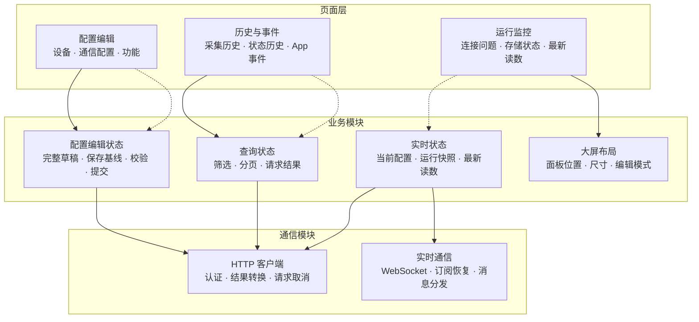
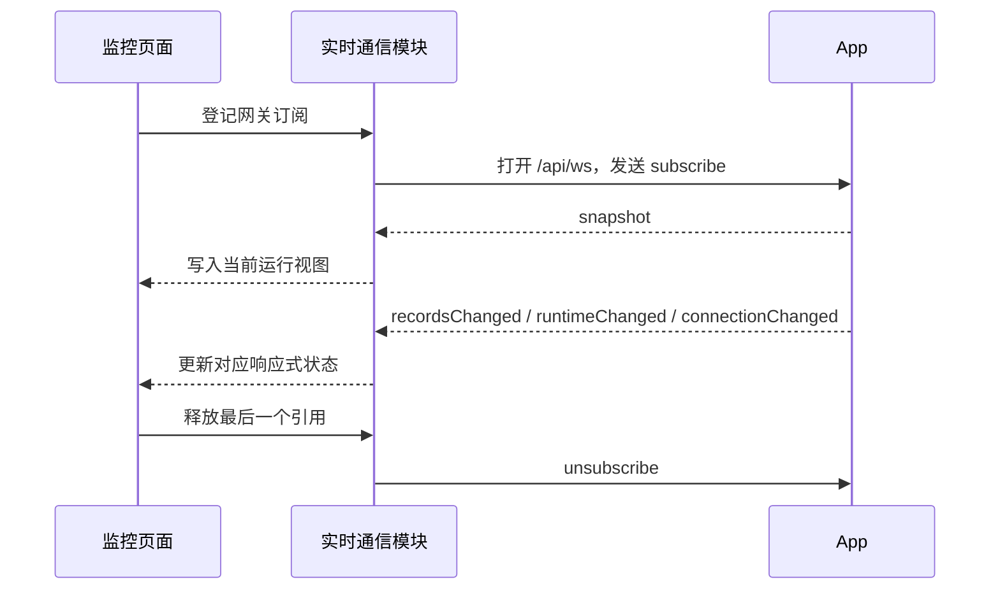

# 前端

前端使用 React + TypeScript + react-grid-layout + ECharts + Tailwind CSS + Vite，负责配置编辑、当前状态与读数展示、历史查询和业务事件查看。HTTP 及 WebSocket 契约见 [App 前端接口](./api.md)，业务字段见[设备模型](./device.md)。本文件定义浏览器内的模块、状态及交互流程。

## 模块结构

页面通过业务模块发起操作，通信模块封装请求与订阅，React 组件订阅业务状态并驱动展示。实线表示调用，虚线表示状态读取。

| 模块 | 职责 |
| --- | --- |
| 配置编辑 | 维护当前网关的完整编辑草稿、最近保存基线和操作状态，生成新增功能 ID，执行交互校验及保存发布流程 |
| 实时状态 | 按网关、设备及功能标识维护 App 提供的当前视图，处理配置变化、订阅数据及连接恢复 |
| 大屏布局 | 使用 react-grid-layout 管理面板位置、尺寸和编辑模式，面板按绑定对象读取实时状态并展示图表 |
| 查询状态 | 分别管理采集历史、网关状态历史和 App 事件的筛选、分页、加载及错误状态 |
| HTTP 客户端 | 调用约定接口，统一处理 ApiResult、认证失败、业务错误及取消，不持有页面编辑状态 |
| 实时通信 | 共享应用级 WebSocket，管理页面所需订阅，按消息类型分发当前快照和变化，报告连接状态并释放无引用订阅 |

模块通过明确的操作入口修改自身状态，页面读取所需字段；通信消息交给对应状态模块处理，直接驱动订阅这些字段的展示组件。

## 技术职责与状态组织

| 技术 | 职责 |
| --- | --- |
| React + TypeScript | 页面、组件、交互及明确的业务类型 |
| react-grid-layout | 大屏面板栅格布局、拖动、尺寸调整及响应式断点 |
| ECharts | 实时读数与历史趋势等图表，按需导入图表类型及组件 |
| Tailwind CSS | 页面及面板内部样式、主题和响应式样式 |
| Vite | 开发服务、热更新及生产构建；Tailwind CSS 通过官方 Vite 插件接入 |

选中项、加载标记和简单编辑状态使用 useState；完整配置草稿及复杂编辑动作使用 useReducer。表单只修改编辑草稿，实时推送只更新运行视图；最近保存基线保持为独立快照，不与可编辑对象共享引用。对象和数组更新遵循不可变语义。

共享运行视图由业务模块持有，通过自定义 Hook 和 useSyncExternalStore 按网关、设备、功能或面板所需范围订阅。快照未变化时返回同一引用，变化时替换相应不可变快照；避免将全部实时读数放入页面顶层状态或一个整体 Context，让每批消息触发整页渲染。读数状态、统计数量及展示列表从已有数据计算，有明确计算成本时使用 useMemo。

组件按业务职责及更新频率拆分，面板使用稳定 ID 作为 key，拖动或尺寸调整保持组件身份。DOM、图表实例、定时器及请求标识使用 useRef。Effect 负责外部订阅和生命周期，保存、发布等用户操作由事件处理入口编排。页面切换时取消不再需要的请求和订阅，卸载时清理监听、定时器及连接引用。

技术依据：[React 外部状态订阅](https://react.dev/reference/react/useSyncExternalStore)、[react-grid-layout](https://github.com/react-grid-layout/react-grid-layout)、[Tailwind CSS 与 Vite](https://tailwindcss.com/docs/installation/using-vite)。

## 大屏布局与图表

大屏布局模块维护面板 ID、面板类型、数据绑定及各断点的栅格位置和尺寸。面板 ID 标识展示组件，数据绑定使用 gatewayId、deviceId、propertyId；同一功能可以被多个面板展示。布局状态与网关配置草稿、实时读数分别管理，拖动和尺寸调整只修改布局。

react-grid-layout 负责面板外部位置与尺寸；Tailwind CSS 负责面板内部排版和样式。编辑模式允许通过面板标题区域拖动并调整尺寸，展示模式关闭拖动及尺寸调整；图表缩放、表单输入等面板内部交互不触发布局拖动。按容器宽度及断点适配栅格，不对整个页面做等比缩放。

图表组件在容器具有有效尺寸后初始化 ECharts，实例放在 ref 中复用。通过 ResizeObserver 监听面板内容区域的实际尺寸变化并调用 resize，覆盖面板拖拽调整、窗口变化及隐藏后重新展示。数据变化通过 setOption 更新，卸载时清理订阅、Observer 和待执行绘制，再 dispose 实例。尺寸调整与数据更新分别处理。

实时曲线的数据接收与绘制分开，先更新展示数据，再通过 requestAnimationFrame 合并同一帧的绘制通知；后台暂停绘制不阻塞消息接收，恢复后读取当前数据。曲线按真实采集时间绘制，异常或缺失结果不补成零值。前端曲线使用实际收到的周期最新记录，需要完整采集历史时调用历史查询。

图表生命周期依据：[ECharts 容器尺寸与销毁](https://echarts.apache.org/handbook/en/concepts/chart-size/)。

## 配置编辑

### 完整草稿与标识

进入配置页面时读取目标网关的草稿，将响应分别作为编辑草稿和最近保存基线。设备、通信配置和功能的新增、修改、删除及迁移都作用于本地完整配置，编辑期间不逐操作发送请求。

新增功能时由前端随机生成 ID，并在当前设备内检查不重复；保存和发布沿用该 ID。功能在同设备内迁移通信配置时移动原功能，复用 ID，不通过删除后重建生成新 ID。设备及通信配置的 ID 分配遵循接口约定，保存后以返回的完整草稿补齐标识。

网关、设备和功能的发布版本由 App 管理，前端展示响应版本，不自行推算变更对象及发布版本。页面的未保存标记表示编辑草稿与最近保存基线不同，仅用于交互提示；实际发布差异由 App 确定。

### 保存与发布

保存粒度为当前网关的完整 GatewayConfiguration，devices、communication、properties 均表示完整集合。请求只序列化配置字段，不携带选中项、表单错误、加载标记等界面状态。

| 操作 | 前端处理 |
| --- | --- |
| 保存草稿 | 取当前完整配置快照，调用 PUT /draft；成功后以返回结果更新编辑草稿及保存基线，失败时保留本地编辑内容 |
| 保存并发布 | 校验可发布配置，先完成一次 PUT /draft，再调用 POST /publish；保存失败时结束流程，发布失败时保留已保存草稿并显示原因 |
| 删除设备、通信配置或功能 | 从本地完整集合中移除目标，保存时提交剩余完整集合 |
| 放弃未保存修改 | 用最近保存基线恢复编辑草稿 |
| 离开有未保存修改的页面 | 提示保存、放弃或继续编辑，由用户选择 |

保存及发布请求使用提交时固定的完整快照，处理期间禁用编辑及重复提交，避免返回结果覆盖请求期间的新编辑。保存草稿允许保留编辑中的未完成参数；发布前检查协议必填项、范围及通信配置的非空功能列表。删除或迁移最后一个功能时，界面提示移除空通信配置或继续补充功能。

发布成功表示 App 已提交配置，页面分别展示发布版本和网关最近上报的生效版本，不将接口成功提示为网关已经应用。网关离线不阻止配置保存及发布。

## 当前状态与读数

当前运行展示使用已发布配置，未发布草稿中的新增、删除和迁移不会直接修改监控页面。页面将网关在线状态、网关运行快照、设备下的连接问题及功能读数分别展示，并提供对应时间。

| 内容 | 展示规则 |
| --- | --- |
| 网关连接 | 使用 App 提供的 online、offline、unknown；前端到 App 的 WebSocket 连接状态单独展示 |
| 网关运行 | 展示最近快照的配置版本、总数、存储状态和生成时间；网关离线时保留快照并标明离线 |
| 设备连接问题 | 按 deviceId、communicationId 归属显示 UNKNOWN 或异常连接及状态开始时间，恢复通知移除对应问题 |
| 功能读数 | 无记录为 unknown，有 value 为 ok，有 code 为 error；正常零值照常显示，异常展示 code |

连接异常或恢复保持功能最近读数及其时间，界面不将连接故障转成全部功能读数错误，也不根据时间流逝自行清空记录。功能展示的精度取记录本身，允许显示旧配置下已在途的结果。功能迁移保持同一 ID 对应的读数展示，配置删除后移除对应当前视图。

实时数据的订阅、分发及恢复遵循下节流程。HTTP 查询与订阅回调均按所属网关及页面请求关联，页面切换后忽略已失效结果。

## WebSocket 使用

### 连接与订阅生命周期

浏览器标签页通过实时通信模块共享一个同源 `/api/ws` 连接，页面组件不各自创建 WebSocket。HTTP 用于配置读写及历史查询，WebSocket 用于运行状态、最新读数及配置变化通知，字段契约见[实时订阅接口](./api.md#websocket-实时订阅)。

1. 监控页面进入时向实时通信模块登记 gatewayId；同一网关的多个消费者共用订阅并维护引用数。
2. 连接打开后生成 subscriptionId，发送 subscribe，运行状态模块标记为同步中。
3. 收到 snapshot 后替换该网关的运行状态和最新记录，读取已发布配置用于设备及功能展示；视图就绪后结束同步状态。
4. 按 subscriptionId、gatewayId 将后续变化路由到对应运行状态，运行视图更新通知订阅对应数据的 React 组件。
5. 最后一个消费者退出时发送 unsubscribe 并注销本地处理入口；全部订阅释放或用户退出登录后关闭连接并清理重连任务。

### 消息消费

| 消息 | 前端处理 |
| --- | --- |
| snapshot | 替换对应网关当前状态和最新记录集合；旧连接及失效订阅的消息直接忽略 |
| recordsChanged | 按 deviceId、propertyId 更新记录，不根据当前配置重新解释采集值或精度 |
| runtimeChanged | 完整替换运行快照及连接问题，异常项从快照中消失即移除展示 |
| connectionChanged | 更新网关连接状态，保留最近运行快照和读数 |
| configChanged | 重新读取已发布配置及运行状态，清理已删除功能的当前展示；本地编辑草稿保持原样 |
| error | 显示对应订阅错误，权限不足停止该订阅，认证失效交给登录流程处理 |

实时通信模块只负责传输及分发，运行状态模块持有当前视图。页面通过订阅 Hook 读取所需状态，事件处理入口不直接修改 DOM。配置刷新期间继续接收当前订阅数据，配置加载完成后按有效对象形成展示视图，避免刷新过程中丢失新记录。

### 断线与重连

连接断开时保留已有显示，明确标记前端与 App 已断开；这不表示 Gateway 离线。存在有效订阅时使用带上限的退避重新连接，连接恢复后以新的 subscriptionId 重建所需订阅，收到 snapshot 前保持同步状态。snapshot 重新建立当前视图，断线期间的记录通过历史查询查看。

重连及恢复不重放保存、发布或查询操作。认证失效、用户注销或全部订阅释放时停止重连；页面通过所属作用域的清理入口释放订阅引用、监听和请求。

## 历史与事件查询

| 页面 | 数据入口及内容 |
| --- | --- |
| 采集历史 | 调用 /history，由 App 代理到网关；按设备、功能和采集时间查询，展示已入库的正常或异常采集结果 |
| 网关状态历史 | 调用 /status-history，由 App 代理到网关；按 occurredAt 查询状态变动历史，上报结果作为附带属性 |
| App 业务事件 | 调用 /events，从 App 事件库查询用户操作、网关接收事件及报错记录 |

每种查询独立保存筛选条件、结果及 nextCursor。首次请求不传 cursor；加载下一页时沿用筛选条件和返回游标，筛选变化后清空结果及游标，重新请求首页。空游标表示结束，同毫秒的不同历史记录按各自记录 ID 保留。

网关状态历史以状态内容及状态时间为主展示，上报是否成功、完成时间及失败原因作为附带信息；上报失败不等同于网关状态异常。网关查询离线、超时及失败按接口结果显示，不用空列表代替错误。
