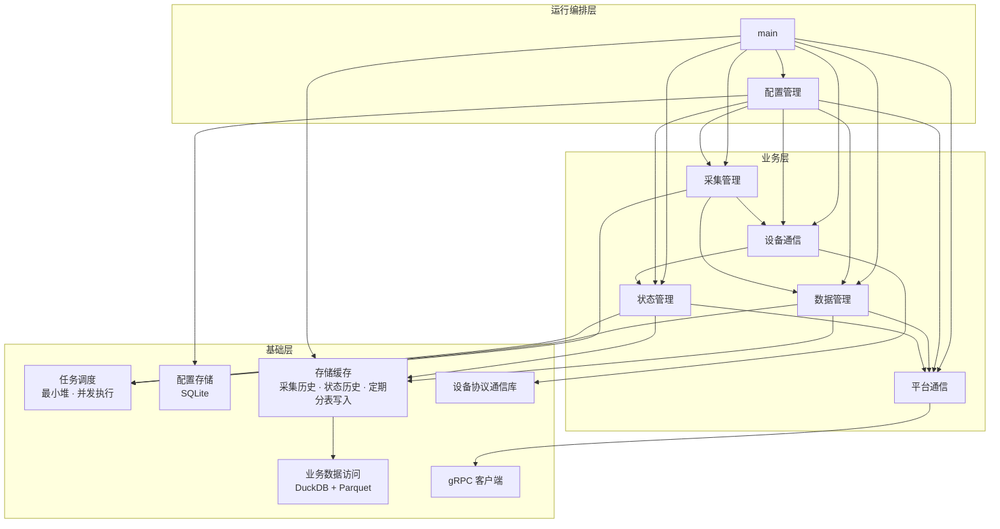

# Gateway

Gateway 管理设备连接和采集任务，按功能配置保存历史，周期上报最新记录，统一上报网关运行状态及当前连接异常，并提供采集历史与状态变动历史查询。

## 运行配置

Gateway 以独立可执行程序运行：

```bash
APP_GRPC_ADDR=app.example.com:443 \
GATEWAY_ID=gateway_001 \
GATEWAY_TOKEN="${GATEWAY_TOKEN}" \
TASK_CONCURRENCY=10 \
SQLITE_PATH=./data/gateway.db \
BUSINESS_DATA_PATH=./data/business \
./dist/gateway
```

App 地址、网关 ID 和 Token 必填。业务数据和配置目录需可写，重启沿用原数据目录。
运行参数包括并发数、缓存容量、上报间隔、状态上报节流间隔、状态队列容量、请求等待超时、配置请求重试间隔、
gRPC Keepalive、退出等待时间，以及本地业务存储的容量与保留时间。
周期上报默认 1000 毫秒，其余参数使用对应运行配置。

## 模块结构

Gateway 按运行编排、业务和基础三层组织。模块通过明确入口直接调用，main 负责装配、初始化、状态查询和资源关闭。Task 属于对应业务模块，调度器只依赖 Task 接口。
箭头表示模块引用方向；业务模块之间保持单向依赖，状态管理维护状态、生成快照、调度上报并提交状态历史，存储缓存负责业务数据持久化。



| 模块 | 内部职责 |
| --- | --- |
| 配置管理 | 配置同步、解析、差异应用与持久化，协调连接、任务、缓存参数和状态更新 |
| 采集管理 | 采集 Task 创建、更新、执行，接收协议回调并处理采集批次 |
| 设备通信 | 驱动实例、连接和协议订阅，向状态管理提交连接故障及恢复结果 |
| 数据管理 | 功能周期最新记录缓存、采集时历史开关筛选、周期上报 Task；将历史交给存储缓存 |
| 状态管理 | 非正常连接集合、固定存储状态项、节流 Task、状态上报 Task、待发送队列；将附带上报结果的状态历史交给存储缓存 |
| 平台通信 | gRPC 双向流、串行写入、消息分发及请求响应关联 |
| 存储缓存 | 采集历史和状态历史的有界待写队列、单个定时写入协程、分表写入、查询、归档与清理 |

main 向平台通信模块注册配置通知、状态、采集历史和状态历史查询入口，平台通信模块按消息类型调用。设备库的订阅回调交给采集处理入口，连接结果直接交给状态管理。main 在启动时注入具体入口，模块持有执行自身职责所需的依赖。
配置存储只返回操作结果，由配置管理更新配置库状态；存储缓存通过 main 注入的存储结果回调更新状态管理中的 collectionDatabase，覆盖历史及状态历史记录的读写、归档和清理。存储缓存只持有该回调，不持有状态管理模块。诊断输出包含必要标识及错误原因，敏感字段脱敏。

### 批次处理与调用边界

一次轮询、合并读取或协议消息产生的结果组成一个批次，采集管理直接调用数据管理的 AcceptBatch(ctx, batch)。每条记录携带本次配置快照中的 storeHistory，Sample 的业务字段遵循[采集记录](./device.md#采集记录)。

```go
type CollectedRecord struct {
    Sample        Sample
    StoreHistory  bool          // 采集时的开关，仅用于历史入队筛选。
    TransformType TransformType // 采集时的精度，异常结果无数值时也需保留。
}

type CollectionBatch struct {
    Records []CollectedRecord // 调用期间只读，接收方复制需要保留的记录。
}
```

AcceptBatch 更新上报缓存，再按 StoreHistory 筛选 Sample 及采集精度并调用存储缓存的历史入队入口。缓存和历史队列各自持有记录，storeHistory 仅用于本地采集处理；历史队列保留 TransformType，正常结果按精度选择数值字段，异常结果保留采集时精度。调用结束后采集方可以释放原始批次。
存储缓存的历史 channel 有界，满时等待写入协程释放空间，等待支持取消。缓存更新在短同步边界内完成，channel 入队在锁外执行。AcceptBatch 执行内存更新与入队，数据库写入和网络发送由独立写入协程及 Task 执行。

| 调用方 | 接收方及处理 |
| --- | --- |
| 采集管理 | 数据管理接收采集批次，更新周期缓存并筛选后交给存储缓存 |
| 设备通信 | 状态管理更新对应 deviceId、communicationId 的连接问题 |
| 配置管理、存储缓存的结果回调 | 状态管理更新配置库及业务数据库状态 |
| 配置管理 | 状态管理在连接状态及生效配置更新完成后检查快照内容变化，登记统一节流 |
| 状态节流 Task | 状态管理将快照加入待发送队列，登记上报 Task |
| 状态上报 Task | 单次上报结束后，将快照异常部分及附带的上报结果作为状态历史交给存储缓存 |

各模块负责自身缓存与状态的同步保护。跨模块调用、channel 等待和调度登记在内部锁外执行；历史与状态历史队列由存储缓存的单个写入协程消费。

## 配置应用

进程重启按已持久化配置和版本初始化连接、任务及状态，设备连接失败照常进入连接状态，记录对应连接异常并继续重连或后续采集，不等待 App 可达或设备全部连接成功。随后建立认证的 gRPC 双向流并携带本地生效版本请求配置，已有采集在同步期间持续运行。
无本地配置时使用版本 0，等待 App 返回已发布配置；App 尚无配置时返回同版本的无增量 ConfigResp，保持空运行状态。App 首次发布配置使用版本 1，Gateway 收到后初始化连接和任务。

收到配置版本通知后，以 ConfigVersionResp 返回简单处理结果并回显通知的 requestId；需要同步时，携带本地生效版本请求配置。获取配置或准备候选配置期间收到更新版本通知时，使当前配置请求失效，以新的 requestId 携带当前生效版本发起配置请求。
以配置请求的 requestId 匹配当前响应，忽略已失效请求的响应。候选配置进入 SQLite 事务前检查请求是否仍有效，忽略已失效请求的准备结果。
每次合法配置请求均处理对应 ConfigResp；目标版本相同时保持运行时，响应不包含更新项。本地版本高于 App 时记录异常，并以 App 返回的全量配置及版本覆盖本地配置。
发送失败、响应超时或 INTERNAL 结果时按配置间隔重试。

App 保证已发布配置的功能完整性和协议参数合法性，Gateway 无需重复进行业务配置校验；Gateway 仍处理消息解析、请求关联、存储和驱动初始化的实际错误。依据[配置集合规则](./protocol.md#配置同步)在本地副本上生成完整候选配置，按 ID 比较受影响功能及连接的运行字段。
按以下顺序应用：

1. 准备差异、不可变配置快照、任务和驱动对象。
2. 在 SQLite 事务中保存完整候选配置及目标版本。
3. 暂停受影响任务，取消需停止的请求和订阅，等待退出并回收相应连接。
4. 调度器更新索引和任务，发起受影响连接的建立或订阅，恢复调度；状态管理移除已删除连接、将新建或重建连接登记为 UNKNOWN，并合入已返回的连接结果。
5. 将目标版本、配置总数和连接状态作为一致的运行时视图生效，内容变化交给状态管理统一节流。后续连接成功或失败通过状态变化继续上报，不等待所有连接完成。

同一网关的配置应用串行执行。从 SQLite 事务开始至运行时应用完成，版本通知仅确认接收并保留最新待同步版本，不中断当前应用。完成后按生效版本判断是否继续请求配置。
应用期间的连接状态变化先归并，配置版本、总数及连接状态一致生效后再触发节流，避免上报新版本与未更新的连接状态组合。
配置请求和状态查询使用运行时生效版本；持久化版本用于启动加载。设备连接建立失败由通信库自动重连或后续采集请求继续尝试，不阻止配置生效。

| 变化 | 运行时处理 |
| --- | --- |
| 上报间隔变化 | 更新周期上报 Task 的间隔及下一次执行时间，同步调整历史批量入库间隔 |
| 功能历史入库开关变化 | AcceptBatch 依据采集批次中的开关决定是否入队，已入队和已入库记录按原流程处理 |
| 新增功能 | 创建 Task；轮询入堆，订阅注册到连接 |
| 删除功能或设备 | 移除 Task，取消采集或订阅，释放无人使用的连接 |
| 采样周期变化 | 更新间隔和下一次时间，调整堆位置；运行实例完成后使用新周期 |
| 读取、解码、转换精度或质量规则变化 | 替换配置快照；在途轮询请求沿用启动时快照，后续请求及订阅消息使用新快照 |
| 订阅目标或过滤条件变化 | 连接模块取消旧订阅并按新配置注册 |
| 连接参数或协议变化 | 暂停受影响功能，取消并等待旧请求退出，关闭旧连接、建立新连接后恢复任务 |
| 功能通信归属变化 | 同设备内复用功能 ID，停止该功能的旧请求或订阅，后续使用目标通信配置的连接；历史查询键保持不变 |

连接变更影响共享该连接的全部功能，无关任务继续运行。取消覆盖通信和结果交入缓存的等待；
配置取消产生的退出不计为连接故障；未完成采集可随取消退出，已产生并交付的结果进入正常缓存及历史处理，不因配置版本变化丢弃。
已完成的在途结果及已缓存数据保持采集时内容，按[采集与周期上报](#采集与周期上报)进入后续处理。状态快照读取一致的生效版本和运行状态。

## 任务调度

每个功能对应一个采集 Task，以 `(deviceId, propertyId)` 定位，设备内迁移通信配置时保持标识。
采集、周期上报、状态节流和状态上报共用调度器，按 nextRun 进入同一最小堆。

| Task | 调度方式 | 占用 TASK_CONCURRENCY |
| --- | --- | --- |
| 采集 | 轮询按采样周期执行；订阅由连接回调接收记录，无定时采集时不入堆 | 轮询执行时占用 |
| 周期上报 | 按上报间隔执行 | 否 |
| 状态节流 | 整个网关共用一个 Task；首次内容变化后 500 毫秒生成完整快照，窗口内更新最新状态，到期执行后移除 | 否 |
| 网关状态上报 | 维护一个 Task，有记录时立即调度，每个快照发送一次，无待发送记录时不入堆 | 否 |

| 索引 | 职责 |
| --- | --- |
| Map | 标识映射到 Task 指针，覆盖待调度、运行及订阅任务 |
| 最小堆 | 保存待执行的 Task，以 nextRun 排序 |

Task 保存标识、类型、nextRun、运行状态和 heapIndex，两种索引共享 Task。周期任务另存执行间隔，未入堆任务 heapIndex=-1。
构造器负责创建 Task 并注入参数及模块依赖；具体 Task 持有执行参数和依赖引用，实现 Execute(ctx) 入口。调度器按执行类别控制并发并调用该入口，业务处理由具体 Task 完成。
采集 Task 持有设备与功能标识、采样参数、解码规则、转换精度及 storeHistory 等不可变配置快照，以及设备通信和数据管理的依赖。
每次执行固定使用本次配置快照；配置更新替换后续执行使用的快照，在途请求沿用启动时快照。订阅消息按接收时的配置快照处理。
最小堆使用 [Go 官方标准库 container/heap](https://pkg.go.dev/container/heap)，交换元素时更新 heapIndex。Map 查询平均 O(1)，Push、Remove、Fix 为 O(log n)。

调度器串行修改索引和调度状态，执行器使用本次快照并返回完成通知。同一 Task 最多一个运行实例。
配置应用期间暂存完成通知，处理时仅允许 Map 仍指向该 Task 且允许调度的实例重新入堆。
轮询采集受 TASK_CONCURRENCY 控制；状态节流 Task 仅生成记录，不占该名额。周期上报和网关状态上报各自最多一个运行实例，不占该名额，避免等待 App 响应挤占采集能力。各类上报共用 gRPC 串行写入入口。
同一通信配置的轮询串行，不同连接可并行，忙碌连接不阻塞其他可执行任务。
周期使用单调时钟，按计划时间推进，跳过错过周期。调度器派发后继续处理其他任务。

## 连接管理

### 设备连接

| 协议 | 通信库 | 数据接收方式 |
| --- | --- | --- |
| Modbus TCP | [goburrow/modbus](https://github.com/goburrow/modbus) | 复用连接，由采集 Task 轮询读取 |
| OPC UA | [gopcua/opcua](https://github.com/gopcua/opcua) | 维护连接和会话；轮询由采集 Task 读取，订阅由库接收通知 |
| MQTT | [eclipse-paho/paho.mqtt.golang](https://github.com/eclipse-paho/paho.mqtt.golang) | 连接外部 broker，通过订阅回调接收消息 |
| TCP | [Go 标准库 net](https://pkg.go.dev/net) | 使用 Listener 接受设备连接，通过 Conn 读取字节流 |

设备连接使用 `Map<communicationId, Connection>` 管理，保存驱动、连接、状态、引用功能、在途请求、订阅及取消入口。
同一通信配置下功能复用连接，不同通信配置独立维护。最后一个功能移除后停止自动重连并关闭连接。
长连接在采集间复用，驱动负责通信、保活、解码和协议错误识别。

MQTT 与 OPC UA 使用库的自动重连，设备通信模块将连接结果直接交给状态管理；连接管理保留驱动实例及当前订阅配置。MQTT 每次连接成功后按当前配置登记订阅，OPC UA 由适配层恢复当前会话下的订阅和监控项。
Modbus TCP 复用驱动持有的连接，Send 在连接为空时尝试建立连接；传输故障由适配层关闭失效连接，下一次采集请求继续尝试。IdleTimeout 默认 30000 毫秒，空闲达到该时长时由库关闭连接，后续请求按需建立连接。连接及响应超时按 timeout 配置分别计时。
轮询连接不可用时，采集 Task 生成相应失败记录。
TCP 以网关本地地址和端口监听，按设备固定 IP 匹配通信配置。同一监听地址由一个 Listener 管理，接入的 Conn 归属于对应通信配置；连接断开后释放 Conn，监听器继续等待设备接入。
每个 TCP Conn 维护独立接收缓冲，将读取到的字节追加后按 framing 循环提取完整帧。固定长度模式每次取出 frameLength 字节；分隔符模式每次取出第一个完整结束符之前的内容，并消耗结束符。剩余的不完整内容保留到下次读取，结束符自身允许跨读取拼接。同次读取中的多帧分别解码，每帧产生的功能记录组成批次交给采集处理入口；连接关闭时丢弃未完成帧并释放缓冲。分隔符模式仅保留长度不超过 maxFrameLength 的未完成帧内容及可能跨读取的结束符前缀；完整帧或未完成内容超过上限时，关闭 Conn、释放缓冲并向状态管理提交 FRAME_TOO_LARGE 连接异常。
连接初始化或重建时向状态管理登记 UNKNOWN 及时间戳。连接首次尝试失败或发生传输故障时调用状态管理登记异常；Modbus TCP 通信成功时清除对应异常，其他协议按库的连接恢复结果清除异常。空闲关闭属于正常资源释放。MQTT 连接状态表示网关与外部 broker 的连接情况。
连接配置变化时停止旧请求及订阅、关闭旧连接，再使用新配置连接。

协议保活由通信库执行，驱动将业务配置映射到协议参数。MQTT Keep Alive 与 TCP Keepalive 不等同于 OPC UA 的会话超时和订阅保活计数；轮询请求使用独立的响应超时。

### 驱动注入

main 在启动时注入协议与驱动构造器的映射。配置应用按协议创建驱动实例，运行中调整功能、订阅和连接；删除配置时关闭对应实例及资源，共用监听器在最后一个使用者移除后关闭。新增协议随网关程序编译发布。

### 平台 gRPC 双向流

平台模块管理 gRPC 客户端和长期双向流，主动建立认证连接，统一串行写流，持续接收和分发消息。
配置、查询和网关状态上报设置响应等待超时，以 requestId 关联结果。周期 ReportReq 写流后完成发送。
底层连接恢复由 gRPC 客户端处理退避重连，平台模块在连接可用后重新建立业务流并请求配置。
Keepalive 用于故障检测，流是否可用与连接、存储异常分别维护。

## 采集与周期上报

驱动支持超时和取消，按功能配置完成解码、数值转换及质量检查，输出统一 code。
读取可合并同连接、相同 slaveId、兼容方式的同轮到期连续寄存器，结果拆分为功能记录；订阅按收到的消息生成记录。

采集管理将结果组成批次并调用 AcceptBatch：

- 数据管理依据每条记录的 storeHistory 筛选，将符合条件的 Sample 批次交给存储缓存。历史 channel 保存间隔内全部待写数据，同毫秒的多条结果分别保留。storeHistory 固定为采集时的配置快照，配置变化保持已入队及已入库数据的处理规则。
- 上报缓存以 (deviceId, propertyId) 为去重键，保留采集时间最新的正常值或异常 code；同毫秒按 AcceptBatch 接收处理顺序由最后一条覆盖，较旧时间不覆盖。质量检查失败时保存 code，数值与 code 互斥。

周期上报 Task 原子取走当前缓存，创建新缓存接收后续记录。取出的记录组成批次，生成一次 batchId 并写入双向流；空缓存跳过。
历史由存储缓存按 reportInterval 定时批量写入，与周期上报并行；周期上报取走缓存不影响历史队列。

周期批次写流完成或发送失败后释放，下一周期按新缓存上报。ReportReq 为单向消息，App 的处理失败记录在 App。
本地业务数据的批量写入与失败处理由存储缓存负责，配置写入由配置管理负责；各自将结果交给状态管理，更新对应存储状态并处理节流调度。

## 状态维护与上报

### 状态维护与同步

状态管理模块通过直接调用入口维护：

- 存储状态：configDatabase、collectionDatabase 两个固定状态项，分别表示 SQLite 配置库和 DuckDB 业务库，业务库包含采集历史及状态变动历史。各项保存 status、timestamp，初始化为 UNKNOWN，timestamp 取初始化时间；确认正常时为 OK，失败时为语义错误码。状态变化时更新时间，相同状态重复确认保持时间不变。
- 非正常连接：`Map<communicationId, ConnectionIssue>`，保存 deviceId、communicationId、status、timestamp。连接初始化或重建时登记 UNKNOWN，时间取初始化或重建时间；异常时更新为语义错误码及进入该状态的时间；确认正常后移除。

设备、连接和功能总数由配置管理提供，从当前生效配置读取，随生效版本一起生成快照。状态管理保存上述状态、节流标记和待发送快照，正常连接数量及问题连接数量由配置总数和 Map 内容派生。
配置管理及存储缓存的结果回调根据实际操作结果更新状态：配置读写、业务数据读写、归档和清理失败使用对应语义码；对应操作恢复成功后清除该操作故障，无未恢复故障时设为 OK，其他操作成功不覆盖尚未恢复的故障。功能采集异常通过 Sample.code 表达，平台连接可用性由 gRPC 流生命周期维护。

配置应用时移除已删除连接的状态项，重建连接登记 UNKNOWN；无关连接保留当前状态。设备通信模块提供初始化、故障及正常确认结果，功能读数由数据管理模块维护。单次功能读取失败通过采集记录表达，连接层确认故障时更新连接问题状态。

状态主动上报仅由以下两类事件触发：

1. 快照业务内容变化：进入下述统一 500 毫秒节流窗口。
2. 平台认证 gRPC 业务流首次就绪或重连就绪：立即生成一份当前完整状态快照并登记发送，不等待配置同步完成，也不要求内容发生变化。

流就绪时使用当前生效配置及运行状态生成快照，并独立发起携带本地生效版本的配置请求。已有设备连接持续运行，受配置影响的连接按新配置建立。配置同步完成本身不触发上报，仅在应用后的快照业务内容变化时触发第一类事件；状态查询只响应请求。

### 变化节流

快照业务内容（生效配置版本、设备/连接/功能总数、connectionIssues 或 storage）变化时调用 dispatch，整个网关共用一个固定 500 毫秒窗口；快照生成时间不参与变化判断：

1. 更新当前运行状态；相同状态重复确认保持状态项时间戳不变，内容未变时跳过调度。
2. 没有待执行 Task 时，创建 500 毫秒后执行的节流 Task，加入最小堆。
3. 已有 Task 时，各类内容变化合入同一窗口，保持执行时间不变，到期读取最新内容。
4. 在同步边界内复制生效配置版本及完整 RuntimeStatus（设备、连接、功能总数、非正常连接及存储状态），生成完整状态快照，清除待执行标记后，在锁外将快照交给发送入口。

流就绪补报直接走发送入口，并清除已被该快照覆盖的待执行节流 Task；复制快照和清除标记在同一同步边界内完成，此后的内容变化开启新窗口。

快照 timestamp 为生成时间，各状态项 timestamp 保留进入当前状态的时间，均始终提供。连接恢复从 connectionIssues 移除；空列表表示快照对应配置中的连接均已确认正常。查询和快照生成由模块内部同步保护。

### 单次发送与状态历史

StatusReportReq 统一上报完整状态快照，维护一个发送 Task 和有界待发送队列：

- Task 每次取出一个完整快照，以独立 requestId 发送一次并等待 ReportResp；收到成功响应记为成功，网关离线、发送失败、非成功响应或等待超时记为失败。超时表示未确认成功，App 可能已收到该快照。
- 每次尝试结束后均将状态历史交给存储缓存，主体为快照生成时间 occurredAt、生效版本、connectionIssues 及 storage 中非 OK 的项；上报 requestId、完成时间 completedAt、success 和失败原因为附带属性。正常快照同样保留历史记录，异常集合为空，后续快照中异常移除表示恢复。
- 状态变化和快照生成只更新内存及发送队列，状态历史在上报结束并附加结果后入队，按 occurredAt 查询及排序，不按上报完成时间排列。尝试结束即移除快照，失败快照不补发；后续内容变化经节流生成新快照，平台流就绪时补当前完整快照。
- 队列满时淘汰最早尚未发送的快照，保留较新快照，输出淘汰数量及时间范围；未尝试的快照不生成状态历史记录。

运行错误同时输出标准错误。

## 历史查询

按 HistoryReq 的设备、功能、采集时间及分页参数查询本地历史，通过双向流返回原始记录。
按采集时间和记录标识稳定排序。查询超时、数据不在保留范围或本地读取失败时返回明确结果。

## 本地存储

配置模块通过 SQLite 事务保存完整配置及版本，写入完成后才能应用并发布生效版本。业务数据统一由存储缓存管理，DuckDB 内使用 history 保存全部采集历史、status_history 保存状态变动历史，并按表归档为 Parquet。history 同时包含 value_float32 FLOAT、value_float64 DOUBLE 和 transform_type 字段，两种精度共用一套写入、查询及归档流程。

存储缓存为采集历史和状态历史记录各设一个有界 channel，由单个协程按 reportInterval 定时消费。每轮记录两个队列当前已排队数量，仅取出这些记录，按目标表分别批量提交；空表跳过。写入期间新记录留待下一轮，一张表写入失败不阻止本轮其他表写入。队列满时在锁外等待，支持取消；入队仅表示已接收，查询只返回已提交数据，进程异常退出可能丢失待写记录。

采集历史按采集时的 transformType 选择 value_float32 或 value_float64，正常结果只写对应数值字段，异常只写 code 并保留精度；不使用写入时的配置重新解释。状态历史保存独立事件 ID，采集历史保存独立记录 ID，同毫秒均可保留多条。两类数据各自设置保留时间及容量，达到上限时按对应业务时间清除最旧一天的数据，覆盖近期表及归档文件。

写入因磁盘空间不足失败时，清理对应数据类别最旧一天的记录后重试本批；仍为空间不足且有可清理数据时继续处理。其他写入错误、清理失败或已无数据可清理时，释放本批、输出错误及丢弃数量，通过存储结果回调登记 collectionDatabase 异常：采集历史使用 HISTORY_WRITE_FAILED，状态历史使用 EVENT_WRITE_FAILED。后续周期继续写入新批次；对应操作恢复成功后清除该操作故障，其他操作成功不覆盖未恢复故障。状态历史写入失败只通过存储状态和标准错误反映，不递归生成入库失败事件。

HistoryReq 与 StatusHistoryReq 直接调用存储缓存查询对应表及归档文件，分别按采集时间与记录 ID、状态历史时间 occurredAt 与事件 ID 稳定分页。App 通过网关流代理两类查询，具体字段见[持久化结构](./database.md)。

运行错误输出标准错误，包含时间、网关及相关设备、功能、请求标识和具体原因。

## 状态与退出

收到 StatusReq 时回送 StatusResp，响应直接包含完整运行状态。
main 从配置管理取得生效版本及设备、连接、功能总数，从状态管理取得非正常连接及存储状态，结构见[状态消息](./protocol.md#状态消息)。
本机 GET /status 从内存读取状态，返回 HTTP 200 和 `{code: 200, data: ...}`。data 包含 gatewayId、timestamp、version 和 status，字段含义与 StatusResp 一致。
其中 timestamp 为本次读取时间。不可达由调用方按连接失败或超时判断。

正常退出时停止新采集派发、设备订阅及重连，等待在途采集完成并交给数据管理。在退出等待时间内保持存储缓存写入协程和必要上报 Task 运行；采集入口退出后，处理周期缓存及待发送状态，等待上报尝试结束并将状态历史入队，再排空采集历史及状态历史队列。最后停止调度和写入协程，关闭设备连接、本地存储及 gRPC 双向流。
